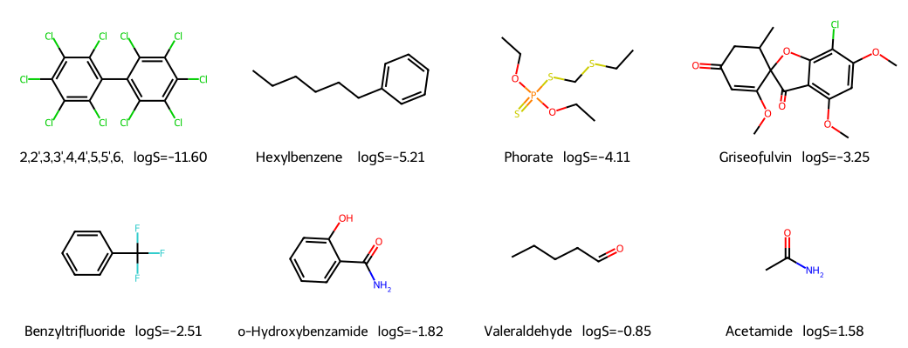
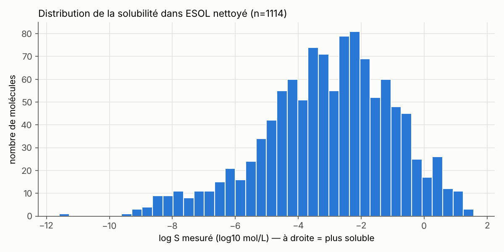

# Leçon 1 — Molécules, SMILES et RDKit

*Étape du laboratoire : `python experiment_runner.py describe` · Durée : 1 h 30*

## 1. Explication intuitive

**Une molécule** est un assemblage d'atomes (carbone C, hydrogène H, oxygène O,
azote N...) reliés par des **liaisons covalentes**. Dans une liaison
covalente, deux atomes partagent des électrons. Chaque atome forme un nombre
typique de liaisons (sa *valence*) : C en forme 4, N 3, O 2, H 1.

On peut donc voir une molécule comme un **graphe** : les atomes sont les
nœuds et les liaisons sont les arêtes. Ce sont la forme de ce graphe et la
nature de ses atomes qui déterminent les propriétés de la molécule, dont la
**solubilité dans l'eau**.

**Pourquoi la solubilité ?** Un médicament pris par la bouche doit d'abord se
**dissoudre** dans les liquides digestifs avant de traverser la paroi
intestinale. Une molécule très active sur sa cible mais insoluble a peu de
chances de devenir un médicament. En découverte de médicaments, on estime donc
la solubilité très tôt, souvent par calcul, avant même de synthétiser la
molécule.

**L'eau aime ce qui lui ressemble.** L'eau est polaire et forme des liaisons
hydrogène. Une molécule avec des groupes polaires (–OH, –NH₂, C=O) se dissout
plus facilement. Une molécule grasse (longues chaînes carbonées, nombreux
cycles aromatiques, atomes de chlore) se dissout mal.
Exemples d'ESOL : l'acétamide (CH₃CONH₂) a log S = +1.58, très soluble ; un
biphényle décachloré a log S = −11.6, pratiquement insoluble.

**L'échelle logarithmique.** La solubilité S est mesurée en mol/L. Comme elle
varie sur plus de 13 ordres de grandeur, on utilise **log S = log₁₀(S)** :
- log S = 0 → 1 mol/L ;
- log S = −2 → 0.01 mol/L ;
- log S = −6 → 0.000001 mol/L.

**Une erreur de 1 en log S = un facteur 10 sur la solubilité.**

## 2. Le langage SMILES

Le **SMILES** (*Simplified Molecular Input Line Entry System*) écrit le graphe
moléculaire sous forme de texte :

| Règle | Exemple | Molécule |
|---|---|---|
| Les atomes s'écrivent par leur symbole ; les H sont implicites | `CCO` | éthanol (CH₃–CH₂–OH) |
| `=` double liaison, `#` triple liaison | `C=O`, `C#N` | méthanal, nitrile |
| Parenthèses = ramification | `CC(=O)O` | acide acétique |
| Chiffres = fermeture de cycle | `C1CCCCC1` | cyclohexane |
| Minuscules = atomes aromatiques | `c1ccccc1` | benzène |
| Crochets = charges, H explicites, isotopes | `[NH4+]`, `[O-]` | ammonium |
| `@`, `/`, `\` = stéréochimie (3D) | `C/C=C/C` | trans-2-butène |

Une même molécule peut s'écrire de plusieurs façons : `OCC` et `CCO` désignent
toutes deux l'éthanol. RDKit calcule un **SMILES canonique**, une écriture
unique par molécule. C'est indispensable pour **détecter les doublons**.

## 3. Visualisation





La distribution est centrée vers log S ≈ −3 avec une longue traîne vers les
molécules très insolubles. Il y a peu d'exemples aux extrêmes, donc les
modèles y seront moins bons.

## 4. Code Python commenté

```python
from rdkit import Chem
from rdkit.Chem import Crippen, Descriptors, Draw

# 1) Lire un SMILES : RDKit construit le graphe moléculaire.
mol = Chem.MolFromSmiles("CC(=O)Oc1ccccc1C(=O)O")   # aspirine
print(mol.GetNumAtoms())          # 13 atomes « lourds » (les H sont implicites)

# 2) Parcourir les atomes du graphe.
for atom in mol.GetAtoms():
    print(atom.GetIdx(), atom.GetSymbol(), "aromatique" if atom.GetIsAromatic() else "")

# 3) SMILES canonique : une écriture unique par molécule.
print(Chem.MolToSmiles(Chem.MolFromSmiles("OCC")))   # 'CCO'

# 4) Deux descripteurs : lipophilie (logP) et masse molaire.
print(round(Crippen.MolLogP(mol), 2), round(Descriptors.MolWt(mol), 1))

# 5) Dessiner la molécule dans un fichier image.
Draw.MolToFile(mol, "aspirine.png")

# 6) Un SMILES invalide renvoie None : il faut TOUJOURS le vérifier.
print(Chem.MolFromSmiles("C1CC"))  # None : le cycle 1 n'est jamais fermé
```

Dans le laboratoire, tout cela est fait par `data_loader.py` (`clean_dataset`),
qui documente chaque décision dans `runs/data_quality.json`.

## 5. Activité pratique (20 min)

1. Activez l'environnement (`source .venv/bin/activate`) et lancez `python`.
2. Exécutez le code ci-dessus.
3. Trouvez dans `data/raw/delaney-processed.csv` la caféine, puis comparez son
   SMILES du fichier au SMILES canonique de RDKit.
4. Lancez `python data_loader.py` et lisez le rapport. Trouvez la paire de
   molécules **exclue** et expliquez pourquoi en une phrase.

## 6. Exercice de compréhension

1. Écrivez le SMILES du propan-1-ol (CH₃CH₂CH₂OH) et du phénol (benzène portant un –OH).
2. Combien de cycles contient `c1ccc2ccccc2c1` ? Quel est son nom ?
3. Classez du plus soluble au moins soluble, sans calcul : hexane `CCCCCC`,
   éthanol `CCO`, benzène `c1ccccc1`. Justifiez.
4. Une molécule a log S = −4 et une masse molaire de 250 g/mol. Combien de
   milligrammes s'en dissolvent dans 1 litre d'eau ?
5. Pourquoi le mannitol et le sorbitol ont-ils le même SMILES dans ESOL alors
   que ce sont deux composés différents ?

## 7. Correction

1. Propan-1-ol : `CCCO`. Phénol : `Oc1ccccc1` (ou `c1ccc(O)cc1`).
2. Deux cycles aromatiques fusionnés : c'est le **naphtalène**.
3. Éthanol > benzène > hexane. L'éthanol porte un –OH qui forme des liaisons
   hydrogène avec l'eau (il est même miscible). Le benzène et l'hexane sont
   apolaires ; le benzène est un peu plus soluble que l'hexane, en partie grâce
   à son nuage d'électrons π plus polarisable. Valeurs dans ESOL : éthanol
   +1.10, benzène −1.64, hexane −3.84.
4. S = 10⁻⁴ mol/L ; 10⁻⁴ mol/L × 250 g/mol = 0.025 g/L = **25 mg/L**.
5. Ils ne diffèrent que par l'orientation 3D de groupes –OH (ce sont des
   **diastéréoisomères**). Le SMILES du fichier ne code pas la stéréochimie
   (`@`) : les deux structures deviennent identiques. Leurs solubilités
   (0.06 et 1.09) diffèrent pourtant d'un facteur 10 : on ne peut pas savoir
   laquelle attribuer à la structure, d'où l'exclusion.

## 8. Bilan des connaissances

- Une molécule est un graphe d'atomes ; ses propriétés découlent de sa structure.
- Le SMILES est une écriture texte de ce graphe ; le SMILES canonique est unique.
- La solubilité s'exprime en log₁₀(mol/L) : 1 unité = facteur 10.
- La qualité des données se **vérifie** (doublons, unités, valeurs manquantes)
  avant tout modèle, et chaque décision se **documente**.
- Limite déjà visible : une représentation 2D perd la stéréochimie et
  l'arrangement du cristal, deux facteurs qui influencent la solubilité.
