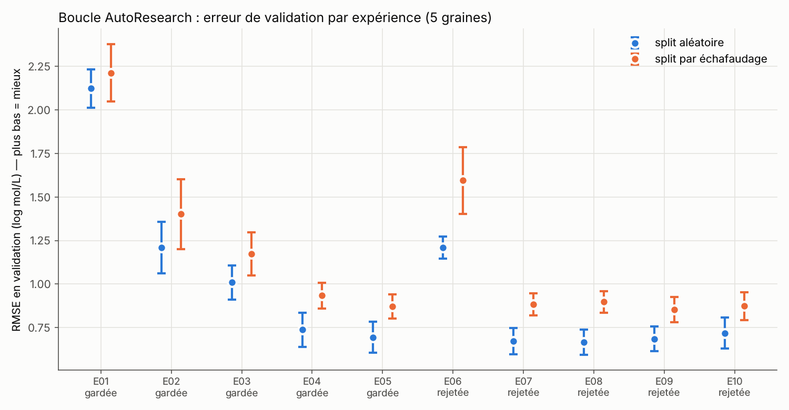

# Leçon 2 — Modèles de référence, régression linéaire et métriques

*Expériences E01, E02, E03 · Durée : 1 h 30*

## 1. Explication intuitive

Avant de construire un modèle compliqué, on se demande toujours :
**« Quel score obtient-on sans rien faire d'intelligent ? »**

- **E01 — prédire la moyenne.** On prédit pour chaque molécule la solubilité
  moyenne de l'entraînement (≈ −3). C'est le niveau zéro : un modèle qui ne
  fait pas mieux n'a rien appris.
- **E02 — régression linéaire sur logP.** Le **logP** mesure la préférence
  d'une molécule pour l'huile (octanol) plutôt que pour l'eau. L'intuition
  chimique dit « plus c'est gras, moins c'est soluble ». Une droite
  `log S = a + b × logP` suffit-elle ?
- **E03 — la forme de l'équation ESOL.** Delaney (2004) a ajouté trois
  descripteurs : masse molaire, liaisons rotatives et proportion d'atomes
  aromatiques. Nous ré-estimons les coefficients sur notre entraînement, avec
  le logP calculé par RDKit.

### Les trois métriques

Pour chaque molécule, l'**erreur** vaut prédiction − mesure.

| Métrique | Formule | Lecture |
|---|---|---|
| MAE | moyenne des \|erreur\| | « en moyenne je me trompe de X log » |
| RMSE | √(moyenne des erreur²) | comme la MAE, mais les grosses erreurs pèsent plus |
| R² | 1 − Σerreur² / Σ(mesure − moyenne)² | part de la variance expliquée. 1 = parfait, 0 = pas mieux que la moyenne, < 0 = pire que la moyenne |

Relation utile : **RMSE ≈ écart-type des données × √(1 − R²)**.

## 2. Résultats réellement obtenus (validation, moyenne ± écart-type sur 5 graines)

| Expérience | RMSE, split aléatoire | RMSE, split scaffold | Décision |
|---|---|---|---|
| E01 moyenne | 2.123 ± 0.110 | 2.213 ± 0.165 | référence |
| E02 linéaire, logP | 1.209 ± 0.148 | 1.402 ± 0.200 | ✅ gardée (Δ −0.863, 10/10 paires) |
| E03 linéaire, 4 descripteurs ESOL | 1.010 ± 0.098 | 1.173 ± 0.123 | ✅ gardée (Δ −0.214, 10/10 paires) |

À lui seul, le logP divise l'erreur par près de 2 : l'intuition chimique est
confirmée. Les trois autres descripteurs d'ESOL apportent un gain net et
régulier.

## 3. Visualisation



Les points orange (split par échafaudage) sont toujours au-dessus des bleus
(split aléatoire). Prédire des familles chimiques jamais vues est plus difficile.

## 4. Code Python commenté

```python
import numpy as np
from sklearn.linear_model import LinearRegression
from sklearn.metrics import mean_squared_error, r2_score
import data_loader, molecule_features as mf

cfg = data_loader.load_config()
df, _ = data_loader.load_dataset(cfg)                      # 1114 molécules propres
split = data_loader.make_split(df, "random", seed=0, fractions=cfg["protocol"]["fractions"])

X, cols = mf.build_features(df["smiles"].tolist(), ["esol4"])  # 4 colonnes
y = df["y"].to_numpy()
tr, va = split["train"], split["valid"]                    # le TEST n'est pas touché

model = LinearRegression().fit(X[tr], y[tr])               # apprend a, b1..b4
pred = model.predict(X[va])
print("coefficients :", dict(zip(cols, model.coef_.round(4))), "constante :", round(model.intercept_, 3))
print("RMSE :", round(np.sqrt(mean_squared_error(y[va], pred)), 3), " R² :", round(r2_score(y[va], pred), 3))
```

Dans le laboratoire, la même chose est faite automatiquement pour 5 graines et
2 types de split par `experiment_runner.py` (fonction `run_experiment`).

## 5. Activité pratique (25 min)

1. Exécutez le code ci-dessus. Les signes des coefficients sont-ils
   chimiquement logiques ? (logP négatif ? masse molaire négative ?)
2. Comparez vos coefficients à ceux publiés par Delaney (source secondaire, à
   vérifier dans l'article) :
   `log S = 0.16 − 0.63·clogP − 0.0062·MW + 0.066·RB − 0.74·AP`.
   Remarque : sans normalisation, la valeur d'un coefficient dépend de l'unité
   de sa variable.
3. Calculez « à la main » (avec Python) la prédiction de l'équation publiée
   pour l'aspirine `CC(=O)Oc1ccccc1C(=O)O`, à partir de `molecule_features.esol4`.

## 6. Exercice de compréhension

1. Sur notre validation, le modèle « moyenne » a un R² légèrement **négatif**.
   Comment est-ce possible alors qu'il prédit la moyenne ?
2. Un RMSE de 0.7 log correspond à quel facteur multiplicatif typique sur la solubilité ?
3. L'écart-type de log S dans ESOL vaut ≈ 2.1. Si un modèle atteint R² = 0.90,
   quel RMSE attendez-vous ?
4. Pourquoi la décision de garder E02 repose-t-elle sur 10 paires (5 graines
   × 2 splits) plutôt que sur un seul découpage ?

## 7. Correction

1. Il prédit la moyenne de l'**entraînement**, pas celle de la validation. Si
   les deux moyennes diffèrent (hasard du découpage, et c'est fréquent en split
   scaffold), il fait un peu moins bien que la moyenne de la validation elle-même.
   Le R² est alors négatif.
2. 10^0.7 ≈ **5** : une prédiction typique est juste « à un facteur 5 près ».
3. RMSE ≈ 2.1 × √(1 − 0.90) ≈ 2.1 × 0.32 ≈ **0.66**. C'est justement l'ordre
   de grandeur obtenu par notre meilleur modèle sur le test, en split aléatoire.
4. Sur un seul découpage, le score dépend beaucoup des molécules tirées au sort
   (l'écart-type entre graines atteint 0.1 à 0.2). En comparant les deux
   modèles **sur les mêmes découpages** et en exigeant un gain sur au moins 8
   paires sur 10, on évite de garder une amélioration due au hasard.

## 8. Bilan des connaissances

- Toute performance se compare à une **référence triviale**.
- La régression linéaire apprend une combinaison pondérée de descripteurs.
  Elle est interprétable, mais ne capture que des effets additifs.
- MAE, RMSE et R² mesurent des choses différentes ; en log S, 1 unité = facteur 10.
- La variabilité entre découpages est grande : il faut plusieurs graines et
  une **comparaison appariée**.
