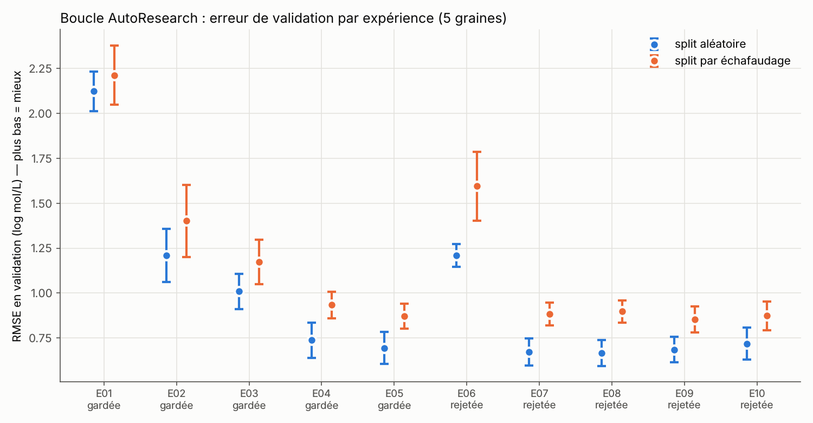
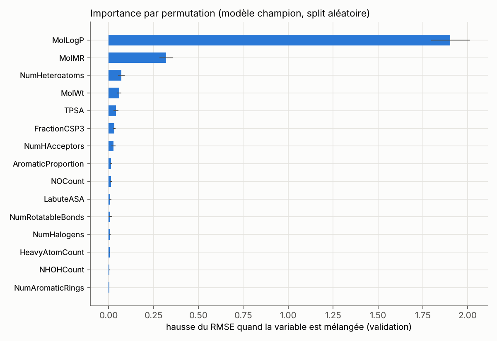

# Leçon 3 — Forêts aléatoires, représentations et découpages

*Expériences E04 à E08 · Durée : 2 h*

## 1. Explication intuitive

### L'arbre de décision
Un arbre pose une suite de questions : « logP > 3.2 ? », puis « TPSA < 40 ? »...
Au bout de chaque chemin, il prédit la moyenne des molécules d'entraînement
arrivées là. Un arbre seul colle trop aux données (**surapprentissage**).

### La forêt aléatoire (Breiman 2001)
On entraîne 500 arbres, chacun sur un **échantillon tiré au hasard** des
molécules d'entraînement. La prédiction finale est la **moyenne** des 500
arbres. Les erreurs individuelles se compensent, et la forêt capture des
effets **non linéaires** et des **interactions**, par exemple « logP compte
plus quand la molécule est grosse ».

⚠️ Propriété importante : une forêt prédit des **moyennes de valeurs vues à
l'entraînement**. Elle ne peut **jamais** prédire en dehors de la plage
observée. Elle « tire vers la moyenne » les molécules extrêmes.

### Deux familles de représentations
- **Descripteurs** (`physchem`, `rdkit_all`) : des nombres globaux qui ont un
  sens physique (logP, surface polaire, nombre de donneurs de liaisons H...).
- **Empreintes de Morgan / ECFP** (`morgan2_2048`) : 2048 cases à 0 ou 1. Chaque
  case indique la présence d'un petit motif local (un atome et ses voisins).
  Très utiles pour reconnaître des sous-structures, moins pour une propriété
  globale et additive comme la solubilité.

### Deux façons de découper
- **Aléatoire** : les molécules de validation ont souvent des « cousines »
  très proches dans l'entraînement. L'évaluation est **optimiste**.
- **Par échafaudage** (Bemis & Murcko 1996) : on retire le squelette cyclique
  de chaque molécule. Toutes les molécules d'un même squelette vont dans le
  même ensemble. Cela simule la question « mon modèle marche-t-il sur une
  **nouvelle famille chimique** ? » (Yang et al. 2019).

## 2. Résultats réellement obtenus (validation)

| Exp. | Modification (une seule à la fois) | RMSE aléatoire | RMSE scaffold | Δ apparié | Décision |
|---|---|---|---|---|---|
| E03 | (référence : linéaire, 4 descripteurs) | 1.010 | 1.173 | — | — |
| E04 | linéaire → **forêt aléatoire** | 0.737 ± 0.097 | 0.934 ± 0.073 | −0.256 (10/10) | ✅ gardée |
| E05 | 4 → **19 descripteurs** physico-chimiques | 0.694 ± 0.090 | 0.873 ± 0.070 | −0.052 (9/10) | ✅ gardée |
| E06 | descripteurs → **empreintes de Morgan seules** | 1.211 ± 0.063 | 1.595 ± 0.192 | +0.620 (0/10) | ❌ rejetée |
| E07 | descripteurs **+** empreintes | 0.673 ± 0.075 | 0.884 ± 0.064 | −0.005 (6/10) | ❌ rejetée |
| E08 | 19 → **~217 descripteurs** RDKit | 0.667 ± 0.071 | 0.897 ± 0.063 | −0.001 (6/10) | ❌ rejetée |

**Lecture.**
- Le passage à la forêt aléatoire est **le plus gros gain** de la mission
  après le logP. La relation structure → solubilité n'est donc pas purement linéaire.
- Les empreintes seules sont **nettement moins bonnes**, surtout en split
  scaffold. Les motifs locaux ne se transfèrent pas à de nouveaux squelettes.
  C'était la prédiction a priori : **résultat négatif attendu et confirmé**.
- E07 et E08 améliorent un peu le split aléatoire, mais **dégradent** le split
  scaffold. Ajouter beaucoup de variables aide à « reconnaître des cousines »,
  pas à généraliser. La règle de décision les rejette, et c'est voulu.

## 3. Visualisation





L'importance par permutation mesure de combien l'erreur augmente quand on
mélange une variable au hasard. **MolLogP domine** très largement. Vient
ensuite MolMR (réfractivité molaire, liée à la taille et à la polarisabilité).
⚠️ Des variables corrélées entre elles (MolWt, MolMR, LabuteASA mesurent
toutes la taille) se « partagent » l'importance : une faible importance ne
veut pas dire « inutile ».

## 4. Code Python commenté

```python
import numpy as np
from sklearn.ensemble import RandomForestRegressor
from sklearn.metrics import mean_squared_error
import data_loader, molecule_features as mf

cfg = data_loader.load_config()
df, _ = data_loader.load_dataset(cfg)
X, cols = mf.build_features(df["smiles"].tolist(), ["physchem"])   # 19 descripteurs
y = df["y"].to_numpy()

for split_type in ["random", "scaffold"]:
    s = data_loader.make_split(df, split_type, seed=0, fractions=cfg["protocol"]["fractions"])
    rf = RandomForestRegressor(n_estimators=500, random_state=0, n_jobs=4)  # graine fixée
    rf.fit(X[s["train"]], y[s["train"]])
    pred = rf.predict(X[s["valid"]])
    rmse = np.sqrt(mean_squared_error(y[s["valid"]], pred))
    print(f"{split_type:8s} RMSE validation = {rmse:.3f}")
    # La forêt ne sort jamais de la plage vue à l'entraînement :
    print("   plage entraînement :", y[s["train"]].min().round(2), y[s["train"]].max().round(2),
          "| plage des prédictions :", pred.min().round(2), pred.max().round(2))
```

## 5. Activité pratique (30 min) — votre première expérience AutoResearch

1. Dans `research_config.yaml`, passez `budget.max_experiments` de 10 à 11 et
   notez ce changement dans `research_memory.md`. Changer le budget est permis ;
   changer le `protocol` ne l'est pas.
2. Ajoutez à la fin de la liste `experiments` :
   ```yaml
     - id: E11
       title: "Forêt plus petite (50 arbres)"
       hypothesis: >
         Réduire la forêt de 500 à 50 arbres dégrade peu la précision.
       justification: "L'erreur d'une forêt se stabilise quand le nombre d'arbres augmente (Breiman 2001)."
       base: champion
       change: {params: {n_estimators: 50, min_samples_leaf: 1, max_features: 1.0}}
   ```
3. **Avant de lancer**, écrivez votre prédiction : gardée ou rejetée ?
4. Faites un commit Git (pré-enregistrement), puis lancez `python experiment_runner.py run --only E11`.
5. Lisez la décision et le nouveau bloc de `research_memory.md`.

## 6. Exercice de compréhension

1. Pourquoi les molécules acycliques (313) et les dérivés du benzène (253)
   sont-elles **toujours** en entraînement dans notre split scaffold ? Quelle
   conséquence pour l'interprétation du score scaffold ?
2. Le benzo[a]pyrène et le décachlorobiphényle ont un log S très bas
   (< −8). Pourquoi une forêt aura-t-elle tendance à **surestimer** leur
   solubilité s'il y a peu de molécules aussi insolubles à l'entraînement ?
3. E08 améliore le split aléatoire (0.667 contre 0.694), mais dégrade le split
   scaffold (0.897 contre 0.873). Donnez une explication plausible.
4. Pourquoi des empreintes binaires décrivent-elles mal une propriété
   « additive » comme la lipophilie ?

## 7. Correction

1. Le split « équilibré » place d'abord en entraînement les familles plus
   grandes que la moitié de l'ensemble de validation (~55 molécules). Les
   squelettes « vide » (313) et « benzène » (253) en font partie. Le score
   scaffold mesure donc la généralisation vers des squelettes **plus rares**
   (stéroïdes, hétérocycles, polycycles...). Il ne dit rien des molécules
   acycliques nouvelles, qui sont toujours bien représentées à l'entraînement.
2. Une forêt prédit une moyenne de valeurs d'entraînement. Les feuilles qui
   contiennent ces molécules contiennent aussi des voisines moins extrêmes. La
   moyenne est donc tirée vers le centre : la solubilité est surestimée
   (résidu positif). On le voit sur la figure 4 (leçon 4).
3. Avec 217 variables, le modèle peut exploiter des détails fins qui
   distinguent des **molécules proches**. C'est utile quand la validation
   contient des cousines de l'entraînement (split aléatoire). Ces détails ne
   se transfèrent pas à de nouveaux squelettes et ajoutent du bruit (split
   scaffold). Cette explication est **plausible mais non démontrée** : il
   faudrait la tester, par exemple en sélectionnant des variables.
4. Un bit dit « ce motif est présent », pas combien de fois ni avec quelle
   contribution. Dix chlores et un seul chlore peuvent allumer le même bit,
   alors que chaque chlore augmente la lipophilie. Des empreintes de
   **comptage** corrigeraient partiellement ce défaut (piste proposée par le
   laboratoire).

## 8. Bilan des connaissances

- Une forêt aléatoire = moyenne de nombreux arbres ; elle est non linéaire mais
  ne peut pas extrapoler.
- La représentation compte plus que l'algorithme : de bons descripteurs
  battent largement des empreintes génériques pour cette propriété.
- Le split scaffold est **plus exigeant** et plus réaliste que le split aléatoire.
  Une amélioration qui n'apparaît qu'en split aléatoire est suspecte.
- Un résultat négatif (E06, E07, E08) est un **vrai résultat** : il évite
  de refaire l'expérience et oriente la suite.
