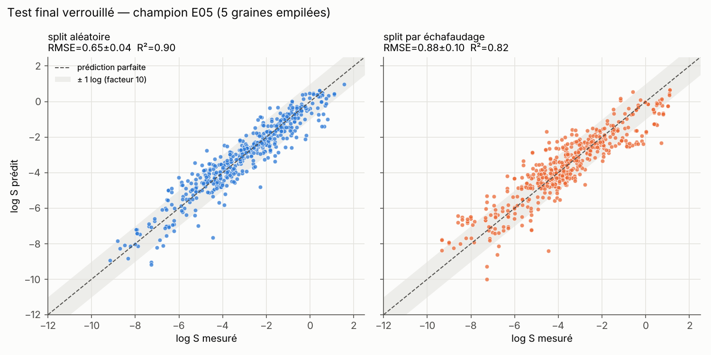
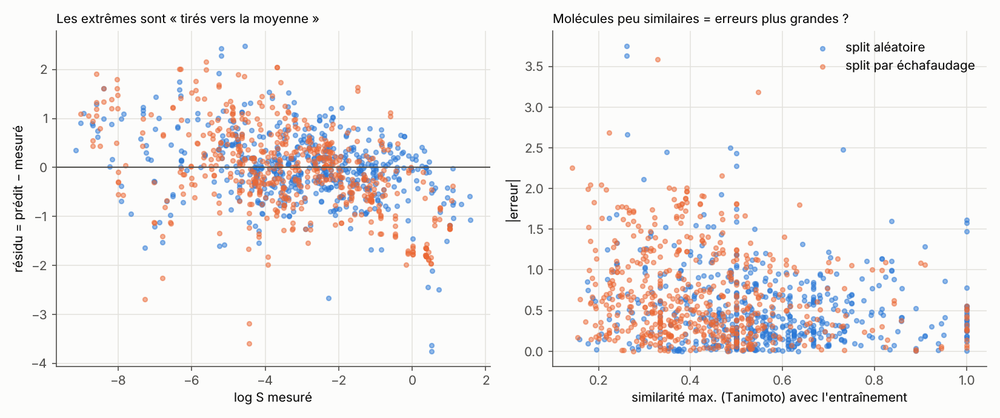

# Leçon 4 — Robustesse, test final, analyse d'erreurs et limites

*Expériences E09, E10 et évaluation finale · Durée : 2 h*

## 1. Explication intuitive

### Trois ensembles, trois rôles
- **Entraînement** (80 %) : le modèle y apprend.
- **Validation** (10 %) : on y compare les idées et on décide « garder / rejeter ».
- **Test** (10 %) : un **coffre-fort**. On l'ouvre une seule fois, à la fin,
  pour estimer honnêtement la performance du modèle choisi.

Si l'on regarde le test pour choisir, il devient un deuxième ensemble de
validation, et le score annoncé est **trop optimiste**. Dans le laboratoire,
la commande `run` ne calcule même pas les prédictions du test. Seule la
commande `final` le fait, et elle refuse de recommencer sans `--force`, qui
est alors tracé.

### Le réglage d'hyperparamètres (E09)
Les **hyperparamètres** sont les réglages du modèle : nombre d'arbres, taille
minimale des feuilles, nombre de variables essayées à chaque division... Pour
les choisir sans tricher, on refait un petit découpage **à l'intérieur de
l'entraînement** (validation croisée interne en 3 plis). En split scaffold,
ces plis sont eux aussi groupés par échafaudage.

### Pourquoi la plupart des « améliorations » disparaissent
L'écart-type entre graines (~0.07 à 0.10 log) est souvent **plus grand** que
le gain recherché (~0.01 à 0.03). Sans comparaison appariée sur plusieurs
découpages, on garderait des améliorations qui ne sont que du bruit.

## 2. Résultats réellement obtenus

### Fin de la boucle (validation)
| Exp. | Modification | Δ RMSE apparié vs E05 | Paires améliorées | Décision |
|---|---|---|---|---|
| E09 | réglage (CV interne) : `max_features` 0.33 choisi 8 fois sur 10 | −0.014 | 7/10 | ❌ rejetée (gain < 0.02, pas assez régulier) |
| E10 | gradient boosting à la place de la forêt | +0.013 | 3/10 | ❌ rejetée |

### Test final verrouillé (5 graines, moyenne ± écart-type)
| Modèle | RMSE aléatoire | R² aléatoire | RMSE scaffold | R² scaffold |
|---|---|---|---|---|
| E01 moyenne | 2.030 ± 0.058 | −0.01 | 2.220 ± 0.135 | −0.16 |
| E02 linéaire, logP | 1.161 ± 0.066 | 0.67 | 1.396 ± 0.150 | 0.54 |
| E03 linéaire, 4 descripteurs ESOL (ré-estimés) | 0.986 ± 0.035 | 0.76 | 1.103 ± 0.117 | 0.72 |
| Prédictions ESOL publiées (Delaney 2004) | 0.865 ± 0.041 | 0.82 | 0.971 ± 0.145 | 0.78 |
| E04 forêt, 4 descripteurs | 0.724 ± 0.025 | 0.87 | 0.921 ± 0.118 | 0.80 |
| **E05 forêt, 19 descripteurs (champion)** | **0.646 ± 0.040** | **0.90** | **0.881 ± 0.105** | **0.82** |

Les scores de test sont cohérents avec ceux de validation (0.69 / 0.87) :
**pas de signe de sur-sélection**.

## 3. Visualisation





- **Gauche** : le résidu (prédit − mesuré) diminue quand la solubilité augmente
  (pente −0.11 en split aléatoire, −0.19 en split scaffold). Les molécules très
  insolubles sont prédites trop solubles, et les très solubles pas assez.
- **Droite** : en split scaffold, le RMSE passe de **1.01** (Tanimoto max < 0.3)
  à **0.58** (≥ 0.7). Plus une molécule est éloignée de tout ce que le modèle a
  vu, plus l'erreur est grande : c'est la notion de **domaine d'applicabilité**.

### Les plus grosses erreurs (validation, `runs/top_errors_validation.csv`)
| Molécule | log S mesuré | Résidu | Lecture chimique (hypothèse) |
|---|---|---|---|
| Dimecron (organophosphoré) | +0.52 | −3.7 | très soluble, prédit insoluble |
| Triéthylphosphate, acéphate | +0.43, +0.54 | −2.5, −2.1 | même famille : esters de phosphate très solubles |
| Simazine (triazine) | −4.55 | +2.5 | plane, cristal stable ? prédite trop soluble |
| Anthraquinone | −5.19 | +2.4 | plane, symétrique, point de fusion élevé ? |
| Carbazole | −5.27 | +1.9 | idem |
| 2-éthyl- et diméthylpyridines | ≈ +0.4 à +0.5 | ≈ −1.8 | petites bases azotées miscibles, sous-estimées |

Ces lectures sont des **hypothèses** à tester (voir `scientific_hypotheses.md`),
pas des conclusions.

### L'incertitude de la forêt est-elle fiable ?
On peut mesurer le désaccord entre les 500 arbres (écart-type des prédictions).
- Split aléatoire : corrélation de Spearman avec l'erreur = **0.38**. Le RMSE
  vaut 0.50 pour les prédictions les plus « sûres » et 0.85 pour les moins sûres.
- Split scaffold : corrélation = **0.07**. **L'indicateur ne fonctionne presque
  plus**, justement là où l'on en aurait le plus besoin.

## 4. Code Python commenté

```python
import numpy as np
from scipy.stats import spearmanr
from sklearn.ensemble import RandomForestRegressor
import data_loader, evaluate, molecule_features as mf

cfg = data_loader.load_config()
df, _ = data_loader.load_dataset(cfg)
X, _ = mf.build_features(df["smiles"].tolist(), ["physchem"])
y = df["y"].to_numpy()

s = data_loader.make_split(df, "scaffold", seed=0, fractions=cfg["protocol"]["fractions"])
rf = RandomForestRegressor(n_estimators=500, random_state=0, n_jobs=4).fit(X[s["train"]], y[s["train"]])

# Prédictions de chaque arbre -> moyenne (prédiction) et écart-type (« incertitude »)
per_tree = np.stack([t.predict(X[s["valid"]]) for t in rf.estimators_])
pred, unc = per_tree.mean(axis=0), per_tree.std(axis=0)
err = np.abs(pred - y[s["valid"]])

# Similarité maximale (Tanimoto, ECFP4) de chaque molécule de validation à l'entraînement
sim = evaluate.max_similarity_to_train(df["smiles"].iloc[s["valid"]].tolist(),
                                       df["smiles"].iloc[s["train"]].tolist())
# Attention : sur UNE graine (ici 0), les corrélations diffèrent de celles du rapport,
# calculées sur les 5 graines réunies. C'est une illustration de la variabilité.
print("Spearman(|erreur|, incertitude) =", round(spearmanr(unc, err).statistic, 2))
print("Spearman(|erreur|, similarité)  =", round(spearmanr(sim, err).statistic, 2))
```

## 5. Activité pratique (30 min) — une expérience d'ablation

Une **ablation** consiste à retirer un ingrédient pour mesurer son importance.

1. Passez `budget.max_experiments` à 12 (si vous avez fait E11) et notez-le
   dans `research_memory.md`.
2. Ajoutez :
   ```yaml
     - id: E12
       title: "Ablation : 19 descripteurs sans le logP"
       hypothesis: >
         Sans logP, les autres descripteurs (taille, polarité) ne compensent
         qu'en partie : le RMSE augmente nettement.
       justification: "Importance par permutation de MolLogP (fig. 5) ; GSE (Ran & Yalkowsky 2001)."
       base: champion
       change: {features: [physchem_sans_logp]}
   ```
3. Écrivez votre prédiction **chiffrée** (RMSE attendu), faites un commit, puis
   lancez `python experiment_runner.py run --only E12`.
4. Comparez : la forêt retrouve-t-elle une partie de l'information du logP à
   partir des autres descripteurs ? Pourquoi est-ce possible ?

## 6. Exercice de compréhension

1. Pourquoi l'analyse d'erreurs est-elle faite sur la **validation** et non
   sur le test ?
2. E09 améliore le RMSE moyen de 0.014 mais est rejetée. Est-ce une erreur
   de la règle ? Que faudrait-il pour conclure qu'il existe un petit effet réel ?
3. Le modèle prédit log S = −3.0 pour une nouvelle molécule, avec une
   similarité maximale de 0.25 à l'entraînement. Comment présenteriez-vous
   cette prédiction à un chimiste ?
4. Un collègue dit : « R² = 0.90, donc notre modèle permet de choisir des
   candidats médicaments solubles. » Donnez trois objections.

## 7. Correction

1. Si l'on modifie le modèle en fonction des erreurs observées sur le test, le
   test influence les choix et n'est plus un estimateur indépendant. La
   validation sert à apprendre et à décider ; le test, seulement à mesurer.
2. Ce n'est pas une erreur : la règle demande un gain **pratique** (≥ 0.02) et
   **régulier** (≥ 8 paires sur 10). Un gain de 0.014 avec 7 paires sur 10 est
   compatible avec le hasard. Pour conclure à un petit effet réel, il faudrait
   plus de graines ou plus de données, et un test statistique apparié (par
   exemple Wilcoxon) **pré-enregistré**.
3. « Prédiction −3.0, mais **hors du domaine connu** du modèle (similarité
   0.25). Sur des molécules aussi éloignées, l'erreur typique observée en
   validation est d'environ 1 log, soit un facteur 10 : la valeur réelle est
   plausiblement entre −4 et −2. À mesurer avant toute décision. »
4. (a) R² = 0.90 vaut pour le split **aléatoire**. Sur de nouvelles familles
   chimiques, il tombe à 0.82 et le RMSE monte à 0.88 log (facteur ~8).
   (b) ESOL contient beaucoup de pesticides, de polluants et de petites
   molécules industrielles, et relativement peu de candidats médicaments
   modernes : le domaine d'applicabilité est différent. (c) La solubilité dans l'eau pure à ~25 °C n'est ni la
   solubilité dans le tube digestif (pH, sels biliaires), ni la
   biodisponibilité, ni l'efficacité. Une prédiction n'est **jamais** une
   preuve d'intérêt thérapeutique.

## 8. Bilan des connaissances

- Train / validation / test : le test est un coffre-fort qu'on n'ouvre qu'une fois.
- Le réglage d'hyperparamètres se fait par validation croisée **interne**.
- La comparaison appariée sur plusieurs découpages évite de prendre le bruit
  pour un progrès. Ici, 5 idées sur 6 après E05 ont été rejetées, et c'est normal.
- L'analyse d'erreurs relie les échecs du modèle à la **chimie** (cristal,
  familles sous-représentées) et produit les hypothèses suivantes.
- Une incertitude du modèle doit elle-même être **validée**, surtout hors domaine.
- Limite biologique : une propriété physico-chimique prédite ne dit rien, seule,
  de l'activité, de la toxicité ou de l'efficacité d'une molécule.
