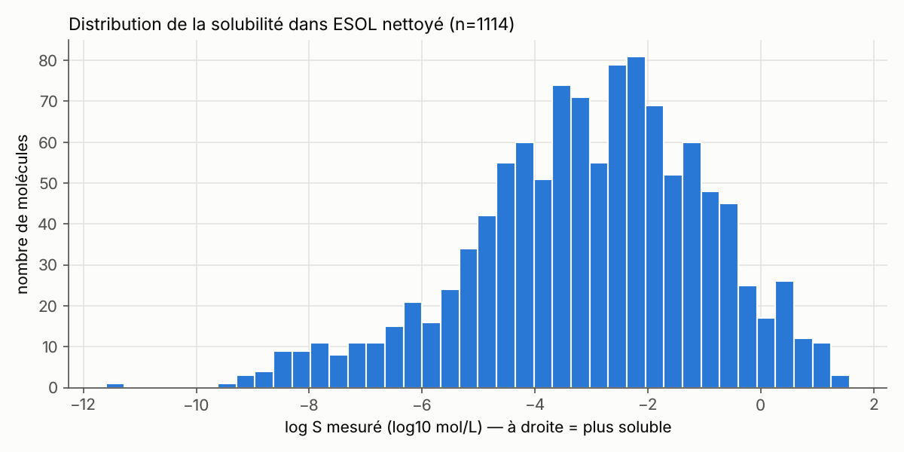
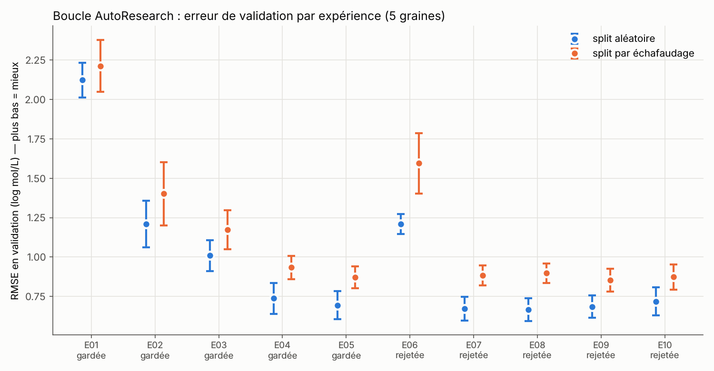
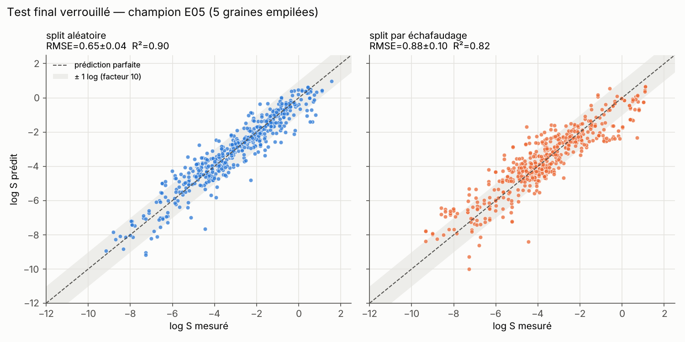
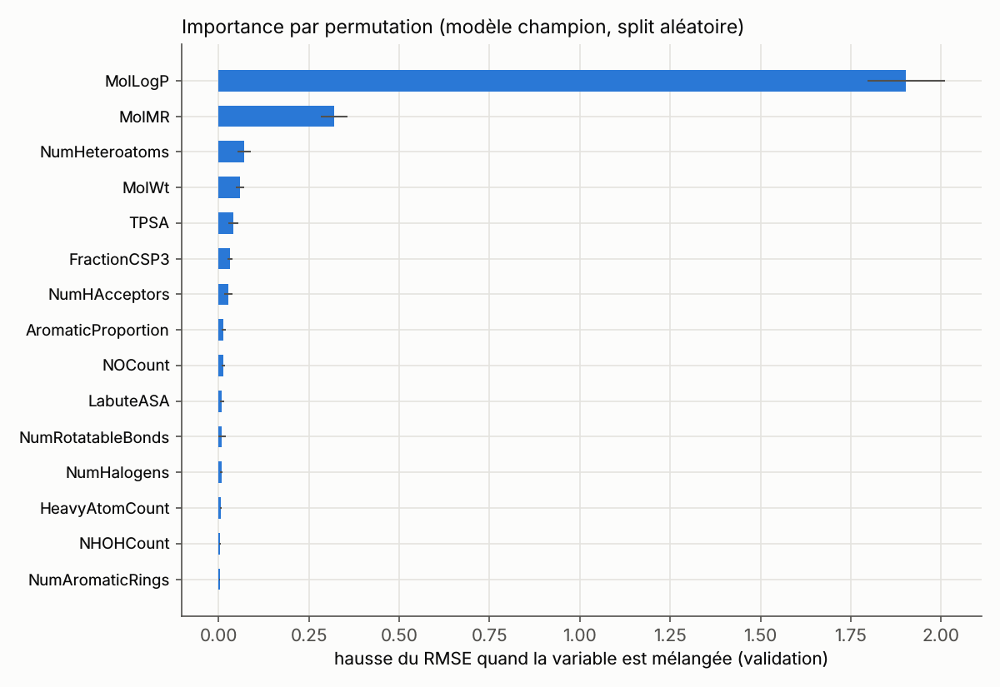
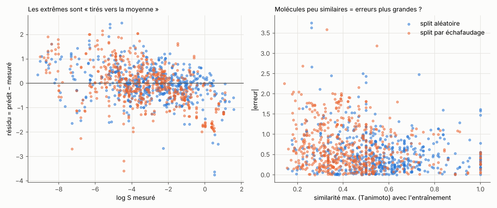

# Rapport scientifique — AutoResearch Biology V1

**Mission M1 : peut-on prédire la solubilité aqueuse d'une molécule à partir de sa structure ?**
*4 novembre 2026 · code : branche `autoresearch-biology-v1`, protocole pré-enregistré au commit `b5ccddf`*

> **Statut épistémique.** Tout ce qui suit est un **résultat computationnel**
> sur un jeu de données public. Aucune prédiction n'est une mesure, et aucune
> ne démontre une propriété biologique ou thérapeutique.
> Le texte distingue les **résultats** (mesurés ici), les **hypothèses**
> (testables, non testées) et les **spéculations**.

---

## Résumé

Nous avons construit un pipeline reproductible, entièrement sur CPU, pour
prédire la solubilité aqueuse (log S, log₁₀ mol/L) de 1114 molécules du jeu
ESOL (Delaney 2004). La boucle « AutoResearch » a testé 10 hypothèses
pré-enregistrées, chacune modifiant **un seul** élément du meilleur modèle
courant. Les décisions ont été prises sur la **validation** uniquement
(5 graines × split aléatoire / par échafaudage, comparaison appariée).

Le modèle retenu, une forêt aléatoire sur 19 descripteurs RDKit (E05), atteint
sur le **test verrouillé** un RMSE de **0.65 ± 0.04** (R² = 0.90) en split
aléatoire et de **0.88 ± 0.10** (R² = 0.82) en split par échafaudage. Sur les
mêmes molécules de test, les prédictions publiées de l'équation ESOL font
0.87 et 0.97. Six des dix hypothèses ont été rejetées, dont toutes celles
postérieures au champion : empreintes moléculaires, 217 descripteurs, réglage
d'hyperparamètres, boosting.

Les erreurs résiduelles se concentrent sur les molécules extrêmes, sur
certaines familles chimiques (esters de phosphate très solubles, molécules
planes prédites trop solubles) et sur les molécules peu similaires à
l'entraînement.

---

## 1. Contexte

La solubilité conditionne l'absorption d'un médicament : une molécule doit se
dissoudre avant de traverser une membrane. Elle dépend de deux phénomènes :
(1) les interactions molécule–eau, approchées par la lipophilie (logP) et la
polarité ; (2) la stabilité du **cristal** à détruire, approchée par le point
de fusion dans l'équation générale de solubilité ([L10] Ran & Yalkowsky 2001).
Une structure 2D décrit bien (1) et mal (2). Cette limite structure tout le
rapport.

## 2. Données

- **Source** : `delaney-processed.csv` (MoleculeNet/DeepChem), SHA-256
  `8c06a76f…f189`, 1128 lignes. Détails et conditions d'utilisation : `data/PROVENANCE.md`.
- **Contrôles** : 0 valeur manquante, 0 SMILES invalide, 0 valeur hors plage.
  Unité : log₁₀(mol/L). Température, pH et méthode de mesure **non renseignés**.
- **Doublons** : 13 groupes de même connectivité (InChIKey, 14 premiers
  caractères). 12 ont été fusionnés (moyenne). 1 a été exclu : mannitol /
  sorbitol, deux diastéréoisomères aux valeurs différentes (0.06 et 1.09)
  confondus par le SMILES sans stéréochimie.
  → **1114 molécules**, 269 échafaudages + 313 molécules acycliques.

## 3. Méthodes

| Élément | Choix |
|---|---|
| Représentations | `logp` (1), `esol4` (4), `physchem` (19), `rdkit_all` (217), `morgan2_2048` (ECFP4, 2048 bits) |
| Modèles | moyenne, régression linéaire, forêt aléatoire (500 arbres), forêt réglée par CV interne, HistGradientBoosting |
| Découpages | 80/10/10 ; **aléatoire** et **par échafaudage de Bemis-Murcko** (variante « équilibrée » inspirée de Chemprop [L3]) ; graines 0–4 |
| Contrôles anti-fuite | aucune molécule (ni échafaudage, en split scaffold) partagée entre ensembles, vérifié à chaque découpage et testé (`tests/`) |
| Prétraitements | imputation et normalisation apprises sur l'entraînement seul (pipelines scikit-learn) |
| Sélection | **validation uniquement** ; test calculé une seule fois (commande `final`) |
| Règle de décision (pré-enregistrée) | garder si Δ RMSE moyen ≤ −0.02 **et** amélioration dans ≥ 8/10 paires (5 graines × 2 splits) |
| Budget | ≤ 10 expériences, ≤ 600 s chacune, ≤ 3600 s au total, 4 cœurs CPU, aucun cloud |
| Environnement | Python 3.12, RDKit 2025.9.3, scikit-learn 1.7.2, NumPy 2.3.5, pandas 2.3.3 (`requirements.txt`) |

## 4. Résultats

### 4.1 La boucle AutoResearch (validation, moyenne ± écart-type sur 5 graines)

| Exp. | Modification vs champion | RMSE alé. | RMSE scaf. | Δ apparié | Paires | Décision |
|---|---|---|---|---|---|---|
| E01 | prédire la moyenne | 2.123 ± 0.110 | 2.213 ± 0.165 | — | — | référence |
| E02 | → linéaire sur logP | 1.209 ± 0.148 | 1.402 ± 0.200 | −0.863 | 10/10 | ✅ |
| E03 | → 4 descripteurs ESOL | 1.010 ± 0.098 | 1.173 ± 0.123 | −0.214 | 10/10 | ✅ |
| E04 | → forêt aléatoire | 0.737 ± 0.097 | 0.934 ± 0.073 | −0.256 | 10/10 | ✅ |
| E05 | → 19 descripteurs | 0.694 ± 0.090 | 0.873 ± 0.070 | −0.052 | 9/10 | ✅ **champion** |
| E06 | → empreintes Morgan seules | 1.211 ± 0.063 | 1.595 ± 0.192 | +0.620 | 0/10 | ❌ |
| E07 | + empreintes Morgan | 0.673 ± 0.075 | 0.884 ± 0.064 | −0.005 | 6/10 | ❌ |
| E08 | → 217 descripteurs RDKit | 0.667 ± 0.071 | 0.897 ± 0.063 | −0.001 | 6/10 | ❌ |
| E09 | → réglage par CV interne | 0.685 ± 0.072 | 0.854 ± 0.073 | −0.014 | 7/10 | ❌ |
| E10 | → gradient boosting | 0.719 ± 0.089 | 0.873 ± 0.079 | +0.013 | 3/10 | ❌ |

Référence littérature (non ré-entraînée) : les prédictions ESOL publiées font
0.903 ± 0.059 (aléatoire) et 1.114 ± 0.136 (scaffold) sur les mêmes ensembles
de validation.

**Détail utile.** E07 et E08 améliorent le split aléatoire (−0.021 et −0.028)
mais **dégradent** le split scaffold (+0.011 et +0.025). L'information ajoutée
aide à reconnaître des molécules proches, pas à généraliser.

### 4.2 Test final verrouillé (évalué une fois, 5 graines)

| Modèle | RMSE alé. | MAE alé. | R² alé. | RMSE scaf. | MAE scaf. | R² scaf. |
|---|---|---|---|---|---|---|
| E01 moyenne | 2.030 ± 0.058 | 1.65 | −0.01 | 2.220 ± 0.135 | 1.75 | −0.16 |
| E02 linéaire logP | 1.161 ± 0.066 | 0.91 | 0.67 | 1.396 ± 0.150 | 1.06 | 0.54 |
| E03 linéaire ESOL (ré-estimé, logP RDKit) | 0.986 ± 0.035 | 0.76 | 0.76 | 1.103 ± 0.117 | 0.88 | 0.72 |
| ESOL publié (Delaney 2004) | 0.865 ± 0.041 | 0.67 | 0.82 | 0.971 ± 0.145 | 0.77 | 0.78 |
| E04 forêt, 4 descripteurs | 0.724 ± 0.025 | 0.53 | 0.87 | 0.921 ± 0.118 | 0.70 | 0.80 |
| **E05 forêt, 19 descripteurs** | **0.646 ± 0.040** | **0.47** | **0.90** | **0.881 ± 0.105** | **0.67** | **0.82** |

Les scores de test sont proches des scores de validation (0.65 contre 0.69 ;
0.88 contre 0.87) : **pas de signe de sur-sélection**.

### 4.3 Reproduction de l'équation ESOL

Ré-estimée sur l'entraînement (graine 0, split aléatoire), l'équation linéaire
à 4 descripteurs donne `log S = 0.19 − 0.75·logP − 0.0065·MW + 0.013·RB − 0.34·AP`.
L'équation publiée (citée par des sources secondaires, à vérifier) est
`0.16 − 0.63·clogP − 0.0062·MW + 0.066·RB − 0.74·AP`. Les signes et les
coefficients de logP et de MW concordent ; RB et AP diffèrent.

Notre version fait **moins bien** que les prédictions ESOL publiées (0.99
contre 0.87 en test aléatoire). Deux explications plausibles, **non
départagées** : (a) le clogP commercial de Delaney est plus précis que le logP
de Crippen de RDKit ; (b) une partie de ces molécules a peut-être servi à
ajuster l'équation publiée, qui ne serait alors pas évaluée hors échantillon.

### 4.4 Qu'apprend le modèle ?

Importance par permutation (validation, split aléatoire, graine 0) :
**MolLogP** (+1.90 de RMSE quand on le mélange) domine. Viennent ensuite
MolMR (+0.32), NumHeteroatoms (+0.07), MolWt (+0.06), TPSA (+0.04),
FractionCSP3 (+0.03). C'est cohérent avec la physico-chimie (lipophilie,
taille, polarité). Les variables corrélées se partagent l'importance.

### 4.5 Analyse d'erreurs (validation, champion E05)

| Mesure | Split aléatoire | Split scaffold |
|---|---|---|
| Pente résidu ~ log S mesuré | −0.11 | −0.19 |
| RMSE si log S < −6 / entre −6 et −2 / ≥ −2 | 0.90 / 0.65 / 0.71 | 1.11 / 0.75 / 1.01 |
| RMSE si Tanimoto max < 0.3 / 0.3–0.5 / 0.5–0.7 / ≥ 0.7 | 1.20 / 0.75 / 0.56 / 0.66 | 1.01 / 0.91 / 0.75 / 0.58 |
| Spearman(\|erreur\|, écart-type entre arbres) | **0.38** | **0.07** |
| RMSE, moitié « sûre » / moitié « incertaine » | 0.50 / 0.85 | 0.86 / 0.89 |

**Résultats.**
1. Retour vers la moyenne : les molécules très insolubles sont prédites trop
   solubles, les très solubles pas assez. C'est attendu d'une forêt, qui ne
   peut pas extrapoler.
2. L'erreur augmente quand la molécule s'éloigne de l'entraînement, ce qui
   montre clairement un domaine d'applicabilité en split scaffold.
3. L'incertitude de la forêt est utile en split aléatoire, mais **ne
   fonctionne presque plus** sur de nouveaux échafaudages.

**Plus grosses erreurs** (`runs/top_errors_validation.csv`) : Dimecron
(résidu −3.7), Naled, triéthylphosphate, acéphate (esters de phosphate très
solubles, sous-estimés) ; simazine (+2.5), anthraquinone (+2.4), carbazole
(+1.9) (molécules planes prédites trop solubles) ; méthyl- et éthylpyridines
(≈ −1.8).

**Hypothèses** (non testées) : (H-M2-1) les surestimations de solubilité
concernent des molécules au cristal très stable (point de fusion élevé) ; les
esters de phosphate forment une famille sous-représentée.

## 5. Discussion

### Ce que nous savons maintenant
- Un modèle simple et interprétable (logP + 18 descripteurs, forêt aléatoire)
  prédit log S avec une erreur typique d'un facteur ~4 (molécules proches de
  l'entraînement) à ~8 (nouvelles familles chimiques).
- Pour cette propriété, **la représentation compte plus que l'algorithme** :
  changer de modèle (E09, E10) ou ajouter des variables génériques (E07, E08)
  n'apporte rien de robuste.
- L'évaluation aléatoire est optimiste d'environ 0.2 log de RMSE par rapport à
  l'évaluation par échafaudage.

### Limites
- **Données** : 1114 molécules, beaucoup de pesticides, de polluants et de
  petites molécules industrielles ; conditions de mesure inconnues (pH,
  température, forme cristalline). Exemple : une entrée est notée « (ph 7) ».
  Plusieurs doublons sont des copies d'une même mesure.
- **Représentation** : 2D seulement ; pas de stéréochimie, pas de cristal, pas d'ionisation.
- **Protocole** : le split scaffold « équilibré » garde toujours les molécules
  acycliques et benzéniques en entraînement. Il n'évalue donc que la
  généralisation vers des squelettes plus rares. Avec 5 graines, on ne
  détecte que des effets supérieurs à ~0.03 log.
- **Comparaisons publiées** : les chiffres de MoleculeNet ne sont pas
  comparables directement (découpages et représentations différents, voir
  `literature_review.md`, §6).
- **Biologie** : la solubilité dans l'eau pure ne prédit ni l'absorption in
  vivo, ni l'activité, ni la toxicité, ni l'efficacité.

### Spéculations (sans test prévu)
- Des modèles de graphes pourraient réduire l'erreur scaffold. Les gains
  publiés existent, mais sur d'autres protocoles. Coût : GPU conseillé.

## 6. Reproductibilité

- Protocole et hypothèses committés **avant** l'exécution (`b5ccddf`).
- Deux exécutions indépendantes (mise au point, puis officielle) donnent des
  `results.csv` **identiques** sur les 34 lignes, hors durées et commit.
- Tout est tracé : configuration et empreinte de chaque expérience, versions
  des bibliothèques, commit, durée (`runs/EXX.json`), prédictions de
  validation (`runs/predictions/`), état complet (`runs/state.json`), test
  (`runs/final_test.json`).
- 17 tests automatiques : absence de fuite, reproductibilité des découpages, métriques, règle de décision.
- Reproduire : voir `INSTALL.md` (≈ 5 à 10 min sur iMac 2017).

## 7. Prochaines étapes

### Mission M2 (recommandée), même jeu de données, une modification à la fois
1. Ablation sans logP (activité de la leçon 4) : quantifier la dépendance au logP.
2. Empreintes de **comptage** (H-M2-2).
3. Indicateur de fiabilité : similarité vs écart-type entre arbres, en validation scaffold (H-M2-4).
4. Points de fusion vérifiés pour un sous-ensemble : tester H-M2-1.
5. Validation **externe** sur AqSolDB, en retirant les molécules d'ESOL (H-M2-3).

### Feuille de route des phases
| Phase | Mission type | Données publiques | Outils | Calcul |
|---|---|---|---|---|
| A — molécules | lipophilie (Lipophilicity, MoleculeNet) ; comparaison de modèles QSAR | MoleculeNet, AqSolDB | RDKit, scikit-learn | iMac |
| B — protéines | séquences → fonction ; propriétés de séquences | UniProt, PDB, AlphaFold DB | Biopython ; petits modèles de langage protéique (ESM, petites tailles) | iMac pour Biopython ; Colab pour les embeddings |
| C — interactions | QSAR sur une cible (ex. données d'activité ChEMBL de la 5α-réductase ou du récepteur des androgènes, deux cibles liées à l'alopécie androgénétique) ; évaluation critique des prédictions | ChEMBL, PubChem, PDB | RDKit, scikit-learn | iMac |
| D — génétique et vieillissement | expression génique selon l'âge ; signatures de sénescence | GEO, GTEx (à vérifier selon le jeu choisi) | pandas, scipy, statistiques | iMac (petits jeux) |
| E — découverte de médicaments | sélection de cibles, prédiction de propriétés, incertitudes, critères de validation expérimentale | ChEMBL, UniProt, littérature | tout ce qui précède | iMac + Colab |

**Calcul cloud (aucune dépense engagée)** : Google Colab et Kaggle Notebooks
offrent des GPU gratuits avec quota ; les conditions exactes sont à vérifier
au moment voulu. Ils suffiraient pour la phase B (embeddings protéiques) et
pour un premier modèle de graphe. Une option payante ne sera proposée
qu'avec une estimation de coût et **votre accord explicite**.

**Contraintes de l'iMac Intel** : RDKit ≤ 2025.9.3 et PyTorch ≤ 2.2.2
(dernières versions publiées pour Mac Intel). DeepChem n'est pas recommandé
en local pour les modèles neuronaux.

## 8. Références

Voir `literature_review.md` : 12 publications dont les métadonnées ont été
recoupées par recherche web. Deux points restent signalés : le DOI de Ran &
Yalkowsky 2001 n'est pas vérifié, et le volume et les pages de MoleculeNet
sont à confirmer. S'y ajoute un billet de blog, explicitement marqué comme non
relu par les pairs.
