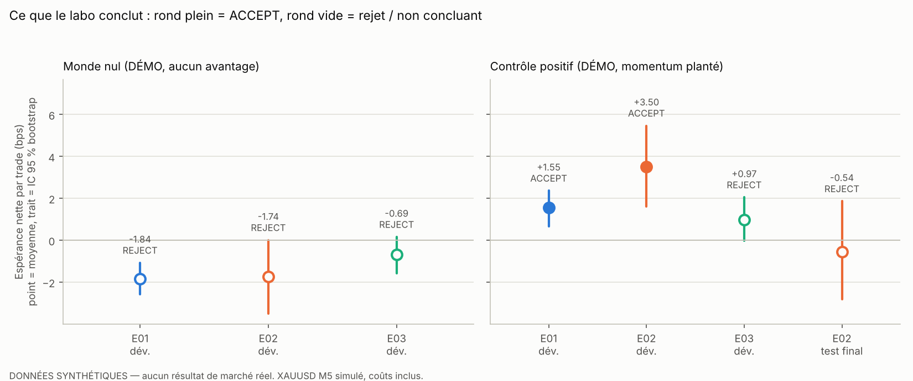
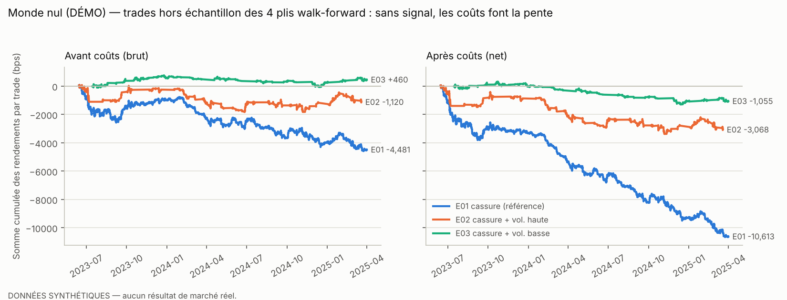

# Rapport scientifique — QuantLab V1

**Expérience n°1 : cassure de canal M5, avec et sans filtre de volatilité, sur XAUUSD**
Date : 2026-11-04 · Code : commit indiqué dans `results.csv` · Évaluateur verrouillé : `evaluation.lock`

> ## ⚠️ À lire avant tout
> **Aucune donnée historique réelle n'a pu être utilisée.** Le réseau de l'environnement de
> développement bloquait toutes les sources de données gratuites (Dukascopy, HistData, Yahoo,
> Stooq). Toutes les expériences de ce rapport ont donc été faites sur un **jeu SYNTHÉTIQUE
> étiqueté DEMO**. **Aucun chiffre de ce rapport n'est une performance de marché.**
>
> Ce que ce rapport démontre : le **laboratoire fonctionne et il est fiable**. Il rejette ce qui
> doit l'être (0 faux positif sur 33 hypothèses testées dans des mondes nuls) et il détecte un
> effet réel quand on en plante un. Ce qu'il **ne dit pas** : si une cassure ou un filtre de
> volatilité fonctionne sur le vrai XAUUSD. Pour le savoir : section 9.

---

## 1. Résumé

| | Monde nul (DÉMO) | Contrôle positif (DÉMO, momentum planté) |
|---|---|---|
| E01 cassure de référence | **REJECT** (net −1,84 bps/trade) | ACCEPT (+1,55) |
| E02 cassure + volatilité haute | **REJECT** (−1,74) | ACCEPT (+3,50), **puis échec au test final** (−0,54) |
| E03 cassure + volatilité basse | **REJECT** (−0,69) | REJECT (+0,97, IC touche 0) |
| E04 sensibilité de E02 (9 configurations) | FRAGILE_OR_NULL (0/9 > 0) | ROBUST (9/9 > 0) |
| Faux positifs sur 10 mondes nuls supplémentaires | **0 / 30** | — |

Trois enseignements, valables au-delà de la démo :

1. Sans avantage réel, **les coûts font la pente**. Environ 1 bp par aller-retour, à 12 trades
   par jour, détruit le capital (E01 : drawdown de −51 % en 21 mois).
2. « Mieux que la référence » ne veut pas dire « bon ». E03 bat la référence (p = 0,015) tout en
   ayant une espérance négative. C'est pour cela que la règle de décision exige **tous** les critères.
3. **Un effet réel peut disparaître au test final** si le régime qui le porte change (§6.2).
   Un backtest ne valide jamais un effet pour toujours.



## 2. Question de recherche

> *Sur XAUUSD M5, une cassure du canal de Donchian 20 barres, tenue 1 heure, a-t-elle une
> espérance nette positive après coûts ? Conditionner la cassure au régime de volatilité
> l'améliore-t-il ?*

**Pourquoi c'est pertinent.** La cassure de range est l'une des règles techniques les plus
utilisées. L'idée que la continuation est plus forte en volatilité élevée a un appui
académique indirect (Gao et al. 2018 : momentum intrajournalier plus fort les jours volatils).
L'idée inverse (« compression puis expansion ») est du folklore praticien. On teste les deux,
**pré-enregistrées** dans `research_config.yaml` avant tout résultat.

**Hypothèses (H0 = ce qu'on cherche à réfuter).**

| ID | H1 (ce qu'il faudrait démontrer) | H0 |
|---|---|---|
| E01 | espérance nette de la cassure > 0 | ≤ 0 |
| E02 | espérance nette en volatilité haute (> 67e centile du train) > 0 **et** > référence | ≤ 0 ou ≤ référence |
| E03 | espérance nette en volatilité basse (< 33e centile du train) > 0 **et** > référence | ≤ 0 ou ≤ référence |

## 3. Données

| | |
|---|---|
| Source | `SYNTHETIC_DEMO(seed=42, planted_edge=0.0)`, hash `636e8307230d031c` |
| Période | 2023-01-02 → 2025-12-31, 1 069 801 barres M1 agrégées en **213 961 barres M5** |
| Propriétés reproduites | queues épaisses (Student-t, ν = 4), volatilité en grappes (2 échelles), saisonnalité horaire, pause quotidienne 21 h UTC, week-ends, spread variable (médiane 0,18 USD) |
| Propriété absente | **aucune prévisibilité des rendements** (dérive et autocorrélation nulles par construction) |
| Contrôle qualité | 0 barre OHLC incohérente, 0 doublon, 35 rendements > 15 MAD (sauts d'ouverture simulés) |

La trajectoire simulée est montée de 2000 à 3443, **par pur hasard**. C'est utile
pédagogiquement : une stratégie acheteuse aurait « gagné » sans aucun talent.

## 4. Protocole de validation

```
2023-01-02                                   2025-04-01              2025-12-31
|<------------------- DÉVELOPPEMENT (75 %) ------------------->|emb|<-- TEST (25 %) -->|
| bloc 0 | bloc 1 | bloc 2 | bloc 3 | bloc 4 |                       VERROUILLÉ
pli 1 : train = bloc 0          -> validation bloc 1 (2023-06-14 -> 2023-11-24)
pli 2 : train = blocs 0-1       -> validation bloc 2 (2023-11-24 -> 2024-05-07)
pli 3 : train = blocs 0-2       -> validation bloc 3 (2024-05-07 -> 2024-10-18)
pli 4 : train = blocs 0-3       -> validation bloc 4 (2024-10-18 -> 2025-04-01)
```

- **Sans fuite d'information** : les variables utilisent les données ≤ t (le test automatique
  le vérifie en tronquant les données). La décision est prise à la clôture de t et **exécutée à
  l'ouverture de t+1**.
- **Walk-forward** : le seuil de volatilité de E02/E03 est réappris sur le train de chaque pli.
  Seuils appris : E02 = 1,139 / 1,093 / 1,100 / 1,090 ; E03 = 0,706 / 0,729 / 0,741 / 0,761.
- **Purge et embargo** : 36 barres (≥ horizon maximal de 24 barres) retirées entre train et
  validation, et entre développement et test.
- **Coûts** (hypothèses, `research_config.yaml`) : demi-spread à l'entrée et à la sortie (spread
  de la barre, plancher 0,10 USD), slippage 0,05 USD par côté, commission 0,07 USD/oz aller-retour.
  Total ≈ 0,35 USD ≈ **1,0–1,1 bp** par aller-retour. Les trades qui enjambent une pause sont refusés.
- **Scénarios de stress** : spread × 2 ; slippage × 4 ; les deux combinés.
- **Règle de décision pré-enregistrée** (`evaluation.decide`). `ACCEPT_CANDIDATE` exige **tous**
  ces critères :
  ≥ 200 trades · IC 95 % bootstrap > 0 · bat les entrées aléatoires (p de Holm < 0,05) ·
  profit factor ≥ 1,10 · ≥ 75 % des plis positifs · net > 0 en stress combiné ·
  (E02/E03) bat la référence (Welch unilatéral, p < 0,05).
- **Référence « hasard »** : 1 000 stratégies qui entrent à des instants aléatoires, avec le même
  nombre de trades, le même horizon et le même ratio achat/vente, **dans les mêmes régimes de
  volatilité et les mêmes sessions**.
- **Tests multiples** : correction de Holm sur toutes les expériences faites sur ces données,
  plus le Deflated Sharpe Ratio avec N = nombre cumulé d'essais.

## 5. Résultats — monde nul (DÉMO)

### 5.1 Tableau principal (trades hors échantillon des 4 plis)

| | E01 référence | E02 vol. haute | E03 vol. basse |
|---|---:|---:|---:|
| Trades | 5 753 | 1 768 | 1 526 |
| Trades / jour | 12,3 | 3,8 | 3,4 |
| Espérance **brute** (bps) | −0,78 (t = −2,02) | −0,63 (t = −0,73) | +0,30 (t = 0,60) |
| Coût moyen (bps) | 1,07 | 1,10 | 0,99 |
| Espérance **nette** (bps) | **−1,84** | **−1,74** | **−0,69** |
| IC 95 % bootstrap | [−2,58 ; −1,07] | [−3,50 ; +0,01] | [−1,57 ; +0,16] |
| Profit factor | 0,83 | 0,87 | 0,90 |
| Taux de gain / ratio gain/perte | 46,6 % / 0,95 | 47,5 % / 0,97 | 47,3 % / 1,00 |
| Plis positifs | 0/4 | 0/4 | 1/4 |
| p (entrées aléatoires) → Holm | 0,981 → 0,981 | 0,772 → 1,000 | 0,295 → 0,884 |
| Deflated Sharpe | 0,000 | 0,012 | 0,033 |
| Net, stress combiné (bps) | −3,28 | −3,21 | −2,05 |
| vs référence (Δ bps, p) | — | +0,11, p = 0,47 | +1,15, p = 0,015 |
| Levier moyen / Sharpe annualisé | 0,88 / −4,1 | 0,63 / −2,1 | 1,21 / −1,8 |
| Drawdown max / Monte Carlo p95 | −51 % / −53 % | −18 % / −21 % | −17 % / −18 % |
| Pertes consécutives max / MC p95 | 16 / 17 | 11 / 14 | 9 / 15 |
| **Décision** | **REJECT** | **REJECT** | **REJECT** |



**Lecture.** Le panneau « brut » oscille autour de zéro : il n'y a pas de signal, comme prévu.
Le panneau « net » descend régulièrement : c'est le coût. E01 trade le plus, donc il descend le
plus vite. Les niveaux des courbes ne sont pas comparables entre eux (nombres de trades
différents) ; ce sont les pentes qui comptent.

### 5.2 Stabilité (E01, espérance nette en bps)

| Session (UTC) | n | net | | Tercile de vol. | n | net | | Sens | n | net |
|---|---:|---:|---|---|---:|---:|---|---|---:|---:|
| Asie 22–7 h | 2 366 | −1,63 | | bas | 1 355 | −0,68 | | achat | 2 906 | −1,18 |
| Londres 7–12 h | 1 318 | −2,26 | | moyen | 2 809 | −2,34 | | vente | 2 847 | −2,53 |
| Chevauchement 12–16 h | 1 061 | −3,13 | | haut | 1 589 | −1,96 | | | | |
| New York 16–22 h | 1 008 | −0,46 | | | | | | | | |

Aucune case n'est positive. Les achats perdent moins que les ventes parce que la trajectoire
simulée est montée : c'est la **dérive**, pas un signal. C'est exactement ce que le test des
entrées aléatoires de même ratio achat/vente neutralise.

### 5.3 Sensibilité des paramètres (E04, grille autour de E02 ; 9 essais comptés)

| hold \ lookback | 10 | 20 | 40 |
|---|---:|---:|---:|
| 6 barres (30 min) | −0,29 | −0,60 | −0,76 |
| 12 barres (1 h) | −1,28 | **−1,74** (E02) | −1,72 |
| 24 barres (2 h) | −1,08 | −2,68 | −1,19 |

0/9 configuration positive → « FRAGILE_OR_NULL ». Le rejet de E02 **ne tient pas** à un choix de
paramètres malchanceux. Remarque : la meilleure case (−0,29) n'est pas une piste. Avec 9 essais,
le meilleur sort toujours un peu du lot par hasard.

## 6. Contrôles : le laboratoire mérite-t-il notre confiance ?

### 6.1 Contrôle négatif : 10 mondes nuls supplémentaires (`--calibrate-null 10`)

E01–E03 ont été rejouées sur 10 mondes sans avantage (graines 1 à 10) : **0/30 acceptées**.
Le t brut a une moyenne de 0,21 et un écart-type de 0,88 (extrêmes −1,91 / +1,77) : c'est le
comportement attendu sous H0. Avec le monde principal, cela fait **0 faux positif sur 33**
(borne supérieure à 95 % ≈ 9 %, règle des 3/n). Le t = −2,02 de E01 dans le monde principal
est donc un hasard ordinaire.

### 6.2 Contrôle positif : momentum planté en volatilité lente élevée (`--control positive`)

| | E01 | E02 | E03 | E04 sensibilité | **E02 test final** |
|---|---:|---:|---:|---:|---:|
| Net (bps) | +1,55 | +3,50 | +0,97 | 9/9 > 0 (2,74 à 4,64) | **−0,54** |
| IC 95 % | [0,67 ; 2,36] | [1,60 ; 5,47] | [−0,03 ; 2,05] | — | [−2,82 ; +1,86] |
| p de Holm | 0,001 | 0,002 | 0,005 | — | 0,42 |
| Décision | ACCEPT | ACCEPT | REJECT | ROBUST | **REJECT** |

Le labo a **la puissance de détecter** un effet réel. Il classe correctement E02 > E01 > E03 et
juge l'effet robuste aux paramètres. **Pourtant, le candidat échoue au test final.** Diagnostic,
vérifié en rejouant le générateur : l'effet planté n'est actif que quand la volatilité *lente*
dépasse sa médiane. C'était le cas **60 % du temps en développement, mais 21 % sur la période de
test**. De plus, notre filtre mesure une volatilité *relative* (1 jour / 20 jours) et non ce
niveau absolu : il filtrait « à côté » du vrai mécanisme.

**Leçon.** Un effet réel, robuste et significatif en développement peut ne pas être exploitable
plus tard, si le régime qui le porte disparaît (cf. Cederburg et al. 2020 sur l'écart entre
échantillon et hors échantillon). Le test final a fait son travail : il a empêché de déployer
une stratégie au mauvais moment. Il a été utilisé **une seule fois** (`runs/controls/test_access.json`).

## 7. Ce que l'on peut conclure, et ce que l'on ne peut pas conclure

**On peut conclure :**
- Le pipeline (données → variables → walk-forward → coûts → évaluation) est **cohérent**,
  **reproductible** (graine 42, hashes dans `results.csv`) et **calibré**. Il rejette les faux
  positifs et détecte un vrai positif.
- Une stratégie sans avantage brut perd environ son coût à chaque trade. À 1 bp/trade et
  12 trades/jour, cela représente **environ 30 % du capital par an à levier 1×**.

**On ne peut PAS conclure :**
- Que la cassure ou le filtre de volatilité « ne marchent pas » sur l'or réel. **Ils n'ont pas
  été testés sur l'or réel.**
- Que la volatilité *cause* quoi que ce soit. Même sur données réelles, un filtre qui marche
  serait une **corrélation conditionnelle**. Le mécanisme (news, liquidité, heure) resterait à
  identifier.

## 8. Limites connues de la V1

- Sortie uniquement temporelle (pas de stop ni d'objectif). Un stop intrabarre exigerait des
  données M1 ou des ticks.
- Spread et slippage modélisés, pas observés. Pas de modèle d'impact de marché (taille de
  position supposée petite).
- Annonces macro non identifiées ; heure d'été/hiver des serveurs MT5 approximée.
- Puissance statistique non quantifiée pour des effets faibles (< 1 bp).
- Un seul marché, une seule famille d'hypothèses (A).

## 9. Prochaines étapes

1. **Données réelles** (bloquant) : `python data_loader.py fetch --start 2023-01-01 --end 2026-10-31`
   sur ton iMac (Dukascopy, gratuit), ou un export MT5 M1/M5 placé dans `data/`. Puis passer
   `data.mode` à `real` et relancer **les mêmes** E01–E03. Elles n'ont jamais vu ces données :
   le pré-enregistrement reste valable.
2. Diagnostics avant toute nouvelle stratégie : ratio de variance par session/régime (H-B1),
   profil horaire rendement/volatilité/spread (H-C1).
3. Puissance : contrôle positif à 0,1 / 0,15 / 0,2 pour connaître le plus petit effet détectable.
4. Famille D (ML) seulement si 2. montre une structure.

## 10. Reproduire ces résultats

```bash
cd quantlab
python -m pytest -q                          # 15 tests anti-fuite / exécution / protocole
python experiment_runner.py --mode demo --auto 2   # E01-E03 + sensibilité (monde nul)
python experiment_runner.py --control positive --auto 1
python experiment_runner.py --calibrate-null 10
python figures.py
```

---

## Annexe — tableau généré automatiquement

<!-- AUTO:START -->
_Tableau régénéré automatiquement le 2026-11-04T01:18:08+00:00._

> **MODE DÉMO — données synthétiques. Aucun chiffre ci-dessous n'est un résultat de marché réel.**

| exp_id | split | data_mode | name | n_trades | gross_exp_bps | cost_bps | net_exp_bps | ci_low_bps | ci_high_bps | profit_factor | win_rate | max_dd_pct | sharpe_ann | frac_folds_positive | p_null | p_null_holm | dsr | stress_combined_net_bps | decision |
|---|---|---|---|---|---|---|---|---|---|---|---|---|---|---|---|---|---|---|---|
| E01 | DEV | DEMO | baseline_breakout | 5753 | -0.779 | 1.066 | -1.845 | -2.582 | -1.073 | 0.828 | 0.466 | -51.431 | -4.078 | 0.000 | 0.981 | 0.981 | 0.000 | -3.282 | REJECT |
| E02 | DEV | DEMO | breakout_high_vol | 1768 | -0.634 | 1.102 | -1.735 | -3.495 | 0.009 | 0.873 | 0.475 | -17.953 | -2.053 | 0.000 | 0.772 | 1.000 | 0.012 | -3.207 | REJECT |
| E03 | DEV | DEMO | breakout_low_vol | 1526 | 0.302 | 0.993 | -0.692 | -1.567 | 0.159 | 0.902 | 0.473 | -16.829 | -1.813 | 0.250 | 0.295 | 0.884 | 0.033 | -2.052 | REJECT |
| E04 | DEV | DEMO | sensitivity_E02 | 15876 |  |  | -1.187 |  |  |  |  |  |  |  |  |  |  |  | FRAGILE_OR_NULL |
<!-- AUTO:END -->
